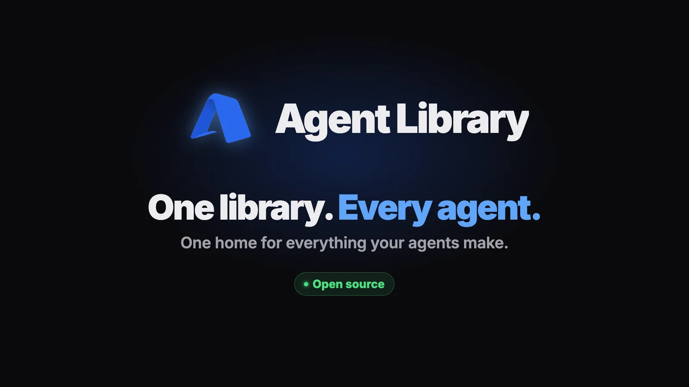
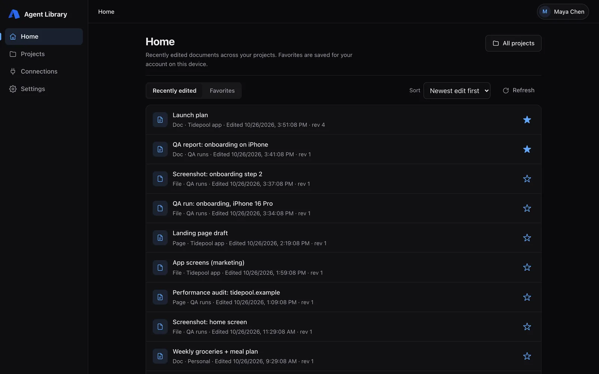
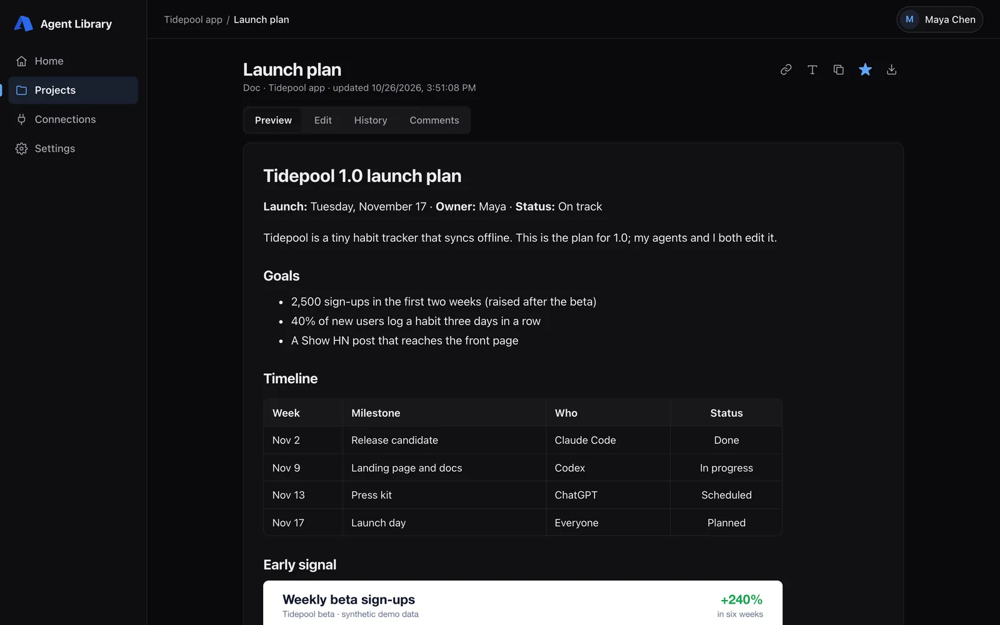
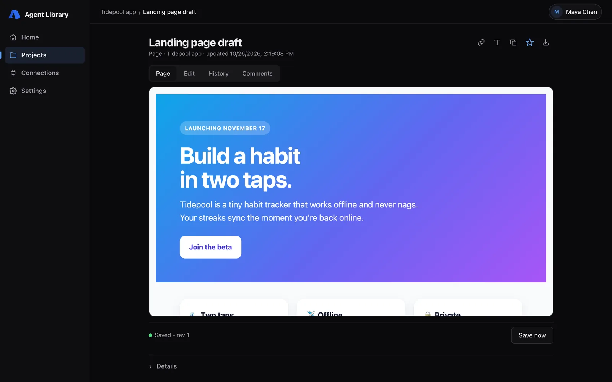
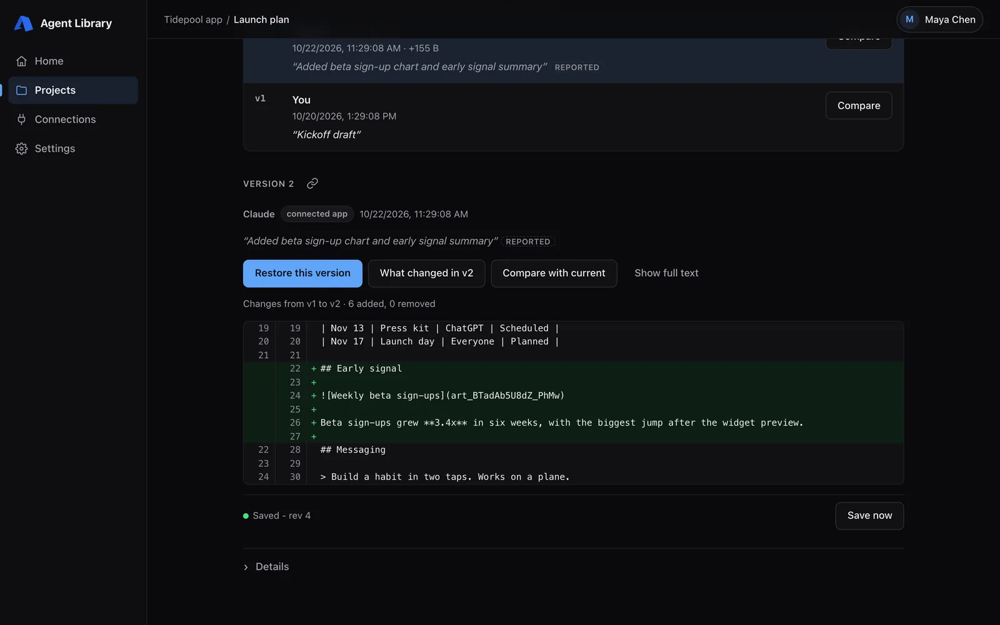
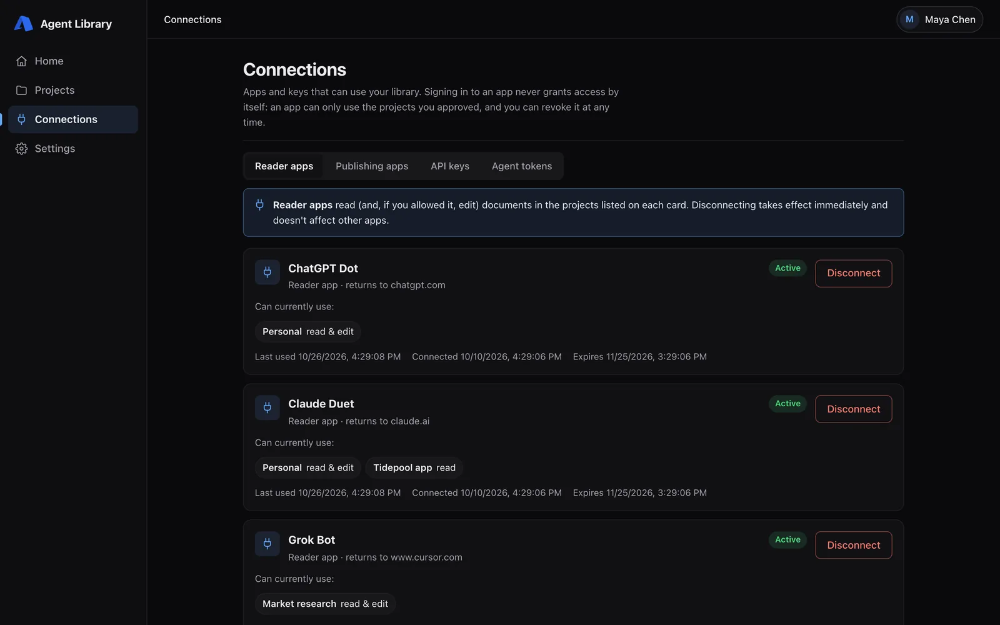
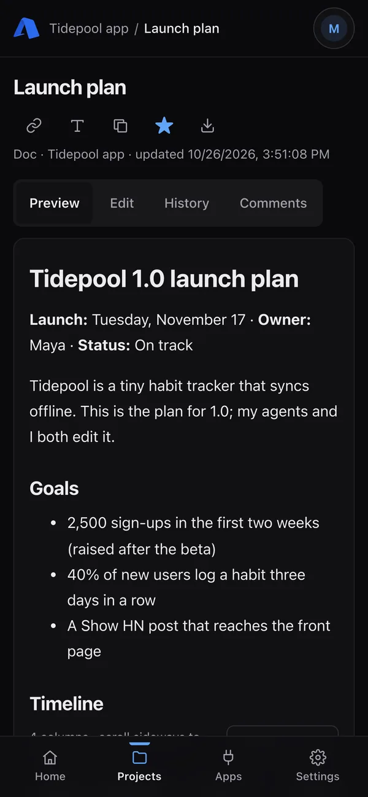

# Agent Library



One place for everything your agents make, with per-agent permissions, first-class Markdown, and linkable artifacts that work across every platform.

Agent Library is a shared home for what your agents produce: Markdown docs, HTML pages, data files, PDFs, screenshots and videos. It all lives in one place instead of being scattered across Claude, ChatGPT, Codex, Cursor and whatever you're trying this week.

- **Any agent, over MCP.** Agents read and write through a standard remote [MCP](https://modelcontextprotocol.io) server with OAuth sign-in, or through a scoped HTTP API. No custom client, SDK or gateway is required.
- **You decide who gets what.** Each agent connection gets explicit, revocable access to specific projects, read-only or read/write. Revoking access takes effect on the agent's next request.
- **Markdown is first-class.** Agents edit Markdown directly, with no conversion step. Every save is an immutable version, so you can see what changed, who changed it and why, and restore any earlier version.
- **Every artifact has a stable link.** Agents return a link with each file, so you can open it on your phone or hand it to another agent. Links open in your library and need your sign-in; they aren't public share links.
- **Apps can keep their own data here too.** With [App Connect](docs/app-connect.md), an app you register gets access only to the files it creates (similar to Google Drive's app data folder). You can still browse, link and share those files from your projects like anything else.
- **Yours, and open source.** It runs in your own Cloudflare account (Workers, D1, R2, KV) and isn't tied to any one model or app. MIT licensed.

## Screenshots

Demo data: a fictional "Tidepool" project.

| | |
|---|---|
|  |  |
| **Home.** Everything your agents made, newest first. | **Documents.** Markdown renders in place; Edit is one tab away. |
|  |  |
| **Pages and files.** HTML, images, PDFs, video and data files. | **Version history.** Who changed what and why, with a diff and one-click restore. |
|  |  |
| **Connections.** Per-agent, per-project access you can revoke any time. | **On your phone.** Every artifact's link opens on mobile too. |

## How it works

One Cloudflare Worker serves two hostnames:

| Host | Who uses it | What's there |
|---|---|---|
| `APP_HOST`, e.g. `library.example.com` | You, in a browser (desktop or phone) | The library UI, behind Cloudflare Access |
| `MCP_HOST`, e.g. `library-mcp.example.com` | Agents and apps | OAuth, the MCP server at `/mcp`, the HTTP API at `/v1` |

D1 stores projects, folders, Markdown, versions, grants and audit records. A private R2 bucket holds immutable binary versions (images, PDFs, video). KV holds OAuth state. A cron job cleans up abandoned uploads.

It is a single-owner library with many agents, not a multi-tenant service. Uploaded HTML and SVG are never executed on the app's origin. Every save is checked against the expected revision, so a conflicting edit preserves your draft instead of overwriting it.

## Set it up

You need a Cloudflare account with a zone (domain) you control, Node 24 and about 20 minutes. The setup is written to be followed by a coding agent: point yours at [docs/self-hosting.md](docs/self-hosting.md) and work through it together. It covers which Cloudflare resources to create and the commands to run.

```sh
git clone https://github.com/<you>/agent-library && cd agent-library
npm ci
cp scripts/self-host/example.json .self-host.json   # fill in your resource IDs and hostnames
npm run setup:self-host -- --input .self-host.json  # offline: validates and stages dist/self-host/
```

Then [connect your agents](docs/agent-setup.md).

## Limits

Agent Library is a personal library: one owner, many agents.

- There are no other human users, public links or real-time co-editing. Agents edit one revision at a time, and conflicting saves are rejected rather than merged.
- Limits: 1 MiB per Markdown or HTML document; 5 MiB per binary file (PNG, JPEG, WebP, GIF, PDF, MP4, WebM) and 100 MiB of binaries per project (adjustable with `PROJECT_BINARY_BYTES`). A project stops accepting new documents once it holds 100 items, counting uploads and trashed items.
- Backups are per project and exclude App Connect projects. See [Operations](docs/operations.md).
- Cloudflare's free tiers cover a typical personal library, but usage beyond them is billed to your account.

## Docs

- [Self-hosting](docs/self-hosting.md): Cloudflare resources, Access sign-in, deploy, acceptance checks.
- [Connecting agents](docs/agent-setup.md): MCP (OAuth) and API keys, scopes, revocation.
- [App Connect](docs/app-connect.md): let your own apps store their data in your library.
- [Architecture](docs/architecture.md): how the pieces fit, the security model and how the bundle is built.
- [Document templates](docs/templates.md): save a Markdown structure once, then start new documents from it in the app or through MCP and the API.
- [Changes feed](docs/project-changes.md): checkpoints, incremental polling, retention and resync.
- [Operations](docs/operations.md): upgrades, backup and restore, rollback.
- [Deploy pipeline](docs/deploy-pipeline.md) (optional): auto-deploy your installation from GitHub on every push to `main`.
- [Version history](docs/version-history.md) and [upload finalization](docs/upload-finalization.md): design notes.

## Development

```sh
npm ci
npm run typecheck
npm run test:deploy        # deploy guards and migration ordering (offline)
npm run check:bundle       # src/index.js rebuilds byte-for-byte from source
npm test                   # full suite: local wrangler, real MCP client, Chrome
npm run dev                # local server on 127.0.0.1:8787 (wrangler.local.toml)
```

Tests use local Wrangler bindings and synthetic fixtures only. Read [CONTRIBUTING.md](CONTRIBUTING.md) and [AGENTS.md](AGENTS.md) before changing code. The deployable Worker is the committed `src/index.js`, built from a pinned baseline plus small reviewed source patches (`npm run build:design`), not a full compile of `src/**/*.ts`.

## Status

Version 0.1.0, the first public release. Please [report anything that doesn't work](https://github.com/croutoncreations/agent-library/issues), and ask setup questions in [Discussions](https://github.com/croutoncreations/agent-library/discussions). Security issues: see [SECURITY.md](SECURITY.md). Contributions are welcome; see [CONTRIBUTING.md](CONTRIBUTING.md) and the [code of conduct](CODE_OF_CONDUCT.md).

## License

[MIT](LICENSE). Third-party components keep their notices in [THIRD_PARTY_NOTICES.md](THIRD_PARTY_NOTICES.md).
